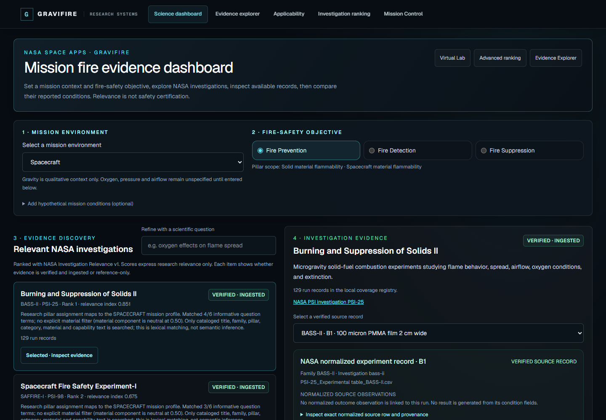
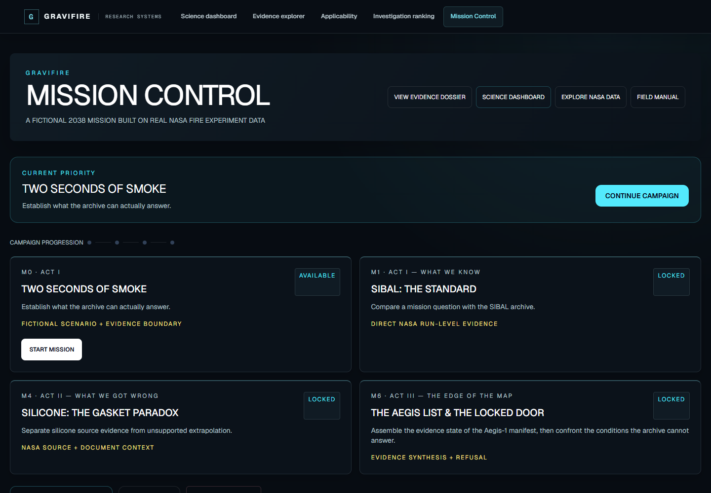
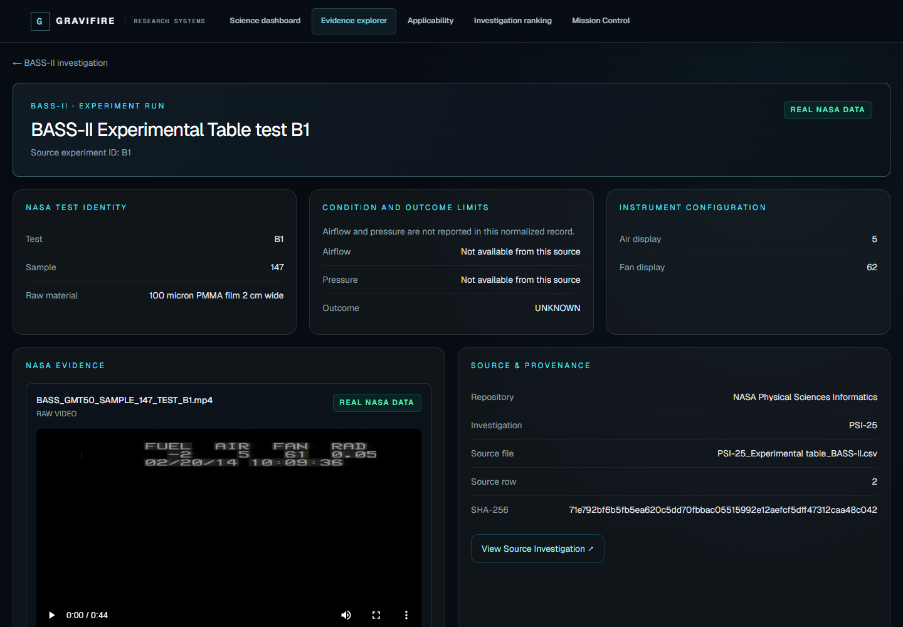

# GRAVIFIRE

**NASA combustion evidence, made understandable and traceable.**

GRAVIFIRE is Team NeuraVesta's NASA Space Apps Challenge 2026 project: an interactive research and learning platform that helps people explore NASA combustion investigations, rank relevant research, and understand where experimental evidence applies, and where it stops.

It connects a scientific dashboard with a fictional spacecraft campaign aboard **ISV Vesta in 2038**. The campaign provides an engaging learning setting; NASA source records provide the scientific evidence. The two are explicitly distinguished throughout the application.

The mission-research concept is practical: use existing combustion evidence to investigate fire prevention, detection and suppression questions before drawing conclusions about a proposed exploration environment. A working browser application connects mission settings with inspectable NASA records, reproducible rankings and explicit evidence gaps.

Read the [project details](docs/PROJECT_DETAILS.md) for the submission narrative covering the mission concept, NASA data, intended impact, technology and design considerations.

**Live website:** [gravifire.vercel.app](https://gravifire.vercel.app)

Start with the [Science Dashboard](https://gravifire.vercel.app/dashboard), or enter [Mission Control](https://gravifire.vercel.app/mission-control).

**Source code:** [github.com/rahat664/gravifire](https://github.com/rahat664/gravifire)

## Screenshots

These application screenshots were captured with Playwright/Chromium using automation written and run by OpenAI Codex (AI assistance). Codex also drafted the descriptions below. The images show the running application; their pixels were rendered by the browser, not synthesized by an image-generation model. Each PNG includes this disclosure in its embedded metadata. See the [AI Usage Declaration](AI_declaration.md).

### Science Dashboard

Choose a mission context and fire-safety objective, then explore relevant NASA investigations and inspect their source records.



### Mission Control

Explore the fictional 2038 campaign, with mission progression and explicit boundaries between the story and NASA evidence.



### Source evidence and provenance

Inspect the BASS-II B1 source record, including reported conditions, unknown outcomes, original media and provenance.



## The problem GRAVIFIRE solves

Finding a relevant combustion experiment is only the first step. A researcher or student also needs to know which material was tested, under what gravity, oxygen, pressure and airflow conditions, what was actually measured, and where the original observation came from.

Those details can be distributed across investigation catalogs, experimental tables, reports and media. Results from one environment cannot simply be treated as answers for a different spacecraft or planetary habitat. Missing measurements can be just as important as available results.

GRAVIFIRE brings the available evidence into one inspectable workflow:

**Choose a mission context -> discover relevant investigations -> inspect a source record -> compare conditions -> interpret the evidence -> identify the next research question.**

It addresses evidence discovery, interpretation and scientific communication. It does not replace experimental testing or provide a validated spacecraft fire-prediction system.

## From a research perspective

GRAVIFIRE makes research relevance and provenance visible rather than offering an unexplained answer.

- **Source-grounded investigation summaries:** explore NASA investigation identities, research objectives, available records and integration status.
- **Deterministic relevance ranking:** rank investigations using mission relevance, material/phenomenon applicability, environmental matches and evidence completeness. The scoring factors are inspectable and reproducible; an LLM does not generate the scores.
- **Mission-condition comparison:** compare reported experimental conditions with user-entered hypothetical spacecraft, lunar habitat, Mars habitat or pressurized-rover conditions. Parameters remain explicitly **MATCHED**, **MISMATCHED** or **UNKNOWN**, with their units and citations.
- **Evidence DNA:** inspect source identifiers, source files, record references, hashes and available ingestion provenance.
- **EMBER:** ask supported scientific questions and receive responses assembled from structured evidence and deterministic retrieval, with references and limitations. The current implementation does not require an external LLM provider.
- **Research-gap visibility:** distinguish an unanswered question from a negative finding, and make missing measurements or untested conditions visible for further investigation.

The ranking is an application-defined **research discovery aid**, not a NASA-endorsed scoring standard, a fire-risk probability or a material-safety assessment.

### NASA research represented

The catalog includes the following investigation families. Coverage differs by family and is shown in the interface.

| Investigation | NASA PSI identity | What the current integration represents |
|---|---|---|
| BASS | PSI-26 | Reference-only research; no validated runtime run records |
| BASS-II | PSI-25 | Ingested experimental-table records and available linked evidence |
| SAFFIRE-I, II and III | PSI-98, PSI-99, PSI-100 | Ingested source records with family-specific limitations |
| SAME and SAME-R | PSI-102, PSI-101 | Experimental-table entries; not detector-response or alarm-performance measurements |
| FLEX | PSI-69 | Droplet-combustion records with documented source-scope and interpretation caveats |
| FLEX-2 | PSI-68 | Configuration envelopes, not individual completed runs or measured outcomes |

The application also retains other cataloged research and advanced explorers. For exact coverage, provenance and unresolved source discrepancies, see the [dataset coverage report](docs/gravifire-2026/03-dataset-coverage.md) and [expanded coverage report](docs/gravifire-2026/08-expanded-coverage.md).

Deterministic ingestion and validation tools organize attributed source information into inspectable records. Ranking explanations, condition-comparison views and provenance displays help users identify both useful connections and missing evidence. A configuration range does not establish a measured outcome, and a matching oxygen concentration does not resolve a gravity mismatch. These distinctions turn data exploration into more precise questions for future experiments.

Original investigation references link to [NASA's Physical Sciences Informatics repository](https://psi.nasa.gov/). Research documents and source records remain attributable to their original providers.

## From a user's perspective

You do not need to start by knowing a NASA experiment identifier.

1. Open the **Challenge Dashboard** at `/dashboard`.
2. Select a mission environment and **Fire Prevention**, **Fire Detection** or **Fire Suppression**.
3. Review the relevant investigations and their ranking explanations.
4. Open an investigation and select a verified source record.
5. Enter hypothetical mission conditions and inspect matches, mismatches and unknowns.
6. Follow the citations or open **Evidence DNA** to inspect provenance.
7. Ask **EMBER** what the evidence supports, why research was ranked, or what remains unknown.
8. Read the limitations and consider the next experiment needed to answer the remaining question.

For an interactive introduction, enter **Mission Control**. The M0, M1, M4 and M6 experiences connect fictional operational situations with real evidence inspection, a persistent Dossier and explicit scientific boundaries.

The campaign makes source evaluation and uncertainty part of the interaction: players investigate operational questions, inspect evidence and build a dossier as they progress. This is an educational prototype for evidence-informed mission reasoning. Its creative contribution is connecting narrative decisions with the scientific limits of the available records.

### A concrete example

Select **Lunar habitat -> Fire Prevention -> BASS-II -> B1**, then enter a hypothetical oxygen fraction of **22.2%**.

B1's source table reports an initial oxygen fraction of **22.2%**, so that parameter matches. Gravity remains mismatched: BASS-II microgravity evidence does not directly validate lunar partial-gravity behavior. The source identifier **PSI-25:Test-B1** stays attached to the record, and the interface does not invent a B1 combustion outcome when no normalized outcome observation is linked.

This illustrates the product's purpose: help a person understand both the useful evidence and the limits of the comparison.

## How GRAVIFIRE helps people

| Audience | Practical benefit |
|---|---|
| Researchers and engineering students | Find relevant investigations, compare experimental scope and trace claims back to source records. |
| Mission-design and fire-safety research teams | Structure discussions about material, atmosphere and gravity assumptions, and identify evidence needed before drawing stronger conclusions. |
| Educators and learners | Explore how combustion research changes across environments through readable scientific interfaces and an interactive spacecraft setting. |
| Science communicators and reviewers | Inspect the sources behind a demonstration and distinguish a measured result from an interpretation or hypothetical scenario. |

The intended contribution is better-informed research and learning: fewer unsupported extrapolations, clearer questions and more transparent evidence. These are product goals, not measured claims of reduced fire incidents or operational safety improvements.

For future exploration, this workflow can support early discussions about materials, atmospheres and experiments needed before stronger conclusions are possible. The same habits of source traceability and careful interpretation are valuable for fire-safety education on Earth.

The team prioritized scientific accuracy, accessible presentation, reproducible ranking and clear distinctions between observations, interpretations and fiction. Missing measurements and the limits of transferring microgravity findings to lunar or Martian conditions shaped both the scientific interfaces and the campaign.

## Scientific boundaries

- Hypothetical mission settings are not NASA measurements.
- Microgravity findings do not automatically transfer to lunar or Martian partial gravity; the currently verified catalog does not contain direct lunar/Martian partial-gravity combustion records.
- Missing values remain unknown. SAME/SAME-R entries do not establish detector performance, and FLEX-2 configuration ranges do not establish completed experimental outcomes.
- The Virtual Lab supports evidence inspection and hypothetical configuration comparison. Its illustrative visualization is not a validated predictive simulation.
- Fictional campaign events and choices do not create NASA experimental results.
- GRAVIFIRE does not certify materials or habitats as safe and does not imply NASA endorsement.

See the [scientific acceptance assessment](docs/gravifire-2026/16-scientific-acceptance.md), [applicability contract](docs/gravifire-2026/04-applicability-contract.md) and [ranking methodology](docs/gravifire-2026/05-ranking-methodology.md) for the implemented rules and limitations.

## Explore the application

| Interface | Route |
|---|---|
| Home | `/` |
| Challenge Dashboard | `/dashboard` |
| Experiment Explorer | `/experiments` |
| Investigation Ranking | `/recommend/investigations` |
| Applicability Explorer | `/applicability` |
| Virtual Laboratory | `/lab` |
| EMBER / Ask GRAVIFIRE | `/ask` |
| Evidence DNA example | `/experiments/bass-ii/runs/B1` |
| Mission Control | `/mission-control` |
| Evidence Dossier | `/mission-control/dossier` |
| Advanced research views | `/landscape`, `/recommend`, `/challenge` |

## Run locally

The application uses **Next.js 16, TypeScript and pnpm**, with React Three Fiber/Rapier and PlayCanvas used by different game implementations. The active mission routes should not be assumed to share one rendering engine.

React and Tailwind CSS support the application interface, while Three.js underpins the React Three Fiber experiences. Development uses Git/GitHub, Vitest, Playwright and accessibility checks; the live website is hosted on Vercel. The project is software-based and requires no custom hardware. EMBER uses deterministic retrieval and structured response composition, and investigation rankings use inspectable application-defined scoring.

Use a compatible Node.js installation and the pnpm version declared in `package.json`.

```bash
pnpm install --frozen-lockfile
pnpm dev
```

Open [http://localhost:3000](http://localhost:3000).

Verification commands:

```bash
pnpm exec tsc --noEmit
pnpm lint
pnpm test
```

For a production environment, run `pnpm build` followed by `pnpm start`. Keep production builds separate from an active development server's output. Do not share writable `node_modules` directories between environments.

The core grounded assistant uses local evidence and does not need an external model API key. Availability of optional original media depends on the source files included in the environment; a missing asset is not evidence of a scientific outcome.

## Repository and research artifacts

- `src/`: application routes, UI, evidence adapters, scientific contracts and game implementations.
- `data/nasa/`: manifests, normalized artifacts, provenance and ingestion reports.
- `scripts/psi/`: family-specific deterministic ingestion tools.
- `tests/`: scientific, state and application regression tests; browser acceptance lives in `tests/browser-harness/`.
- `Gravifier_research/`: research reports, evidence stores and the `R7_HANDOVER` research bundle.
- `psidata/`: PSI manifests, download tooling and selected original source artifacts.
- `docs/gravifire-2026/`: coverage, methodology, acceptance, accessibility and implementation reports.
- `submission-footage/`: versioned editor indexes and validation metadata; local video exports are ignored by Git.

NASA datasets and third-party assets retain their original terms and attribution. See [asset credits](docs/ASSET_CREDITS.md). Local credentials, dependencies, build output and large media exports are excluded from version control.

**Super Intelligence (SI) use:** OpenAI ChatGPT and Codex helped generate and revise application code, ingestion and validation tools, tests, documentation and capture automation. SI-assisted tooling processes attributed NASA source data deterministically; original NASA measurements and source media are not claimed as SI-generated. See the [SI / AI Usage Declaration](AI_declaration.md) for where and how these tools were used, and [SI usage metadata](SI_USAGE.json) for the machine-readable code and data acknowledgment.

---

Built by **Team NeuraVesta** for NASA Space Apps Challenge 2026. The project supports evidence-based exploration of combustion research; it is not a NASA operational system or a safety certification.
